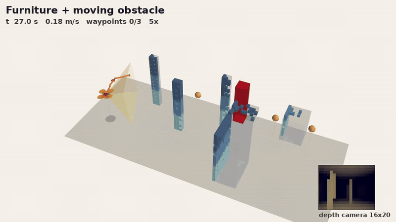
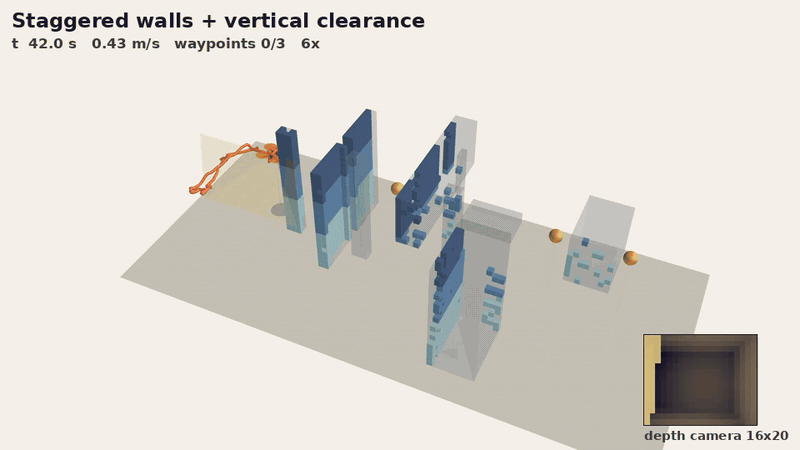
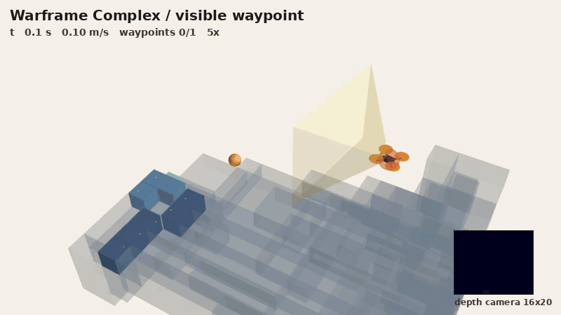
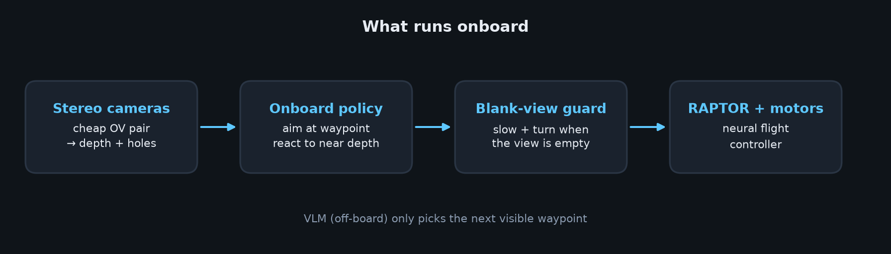
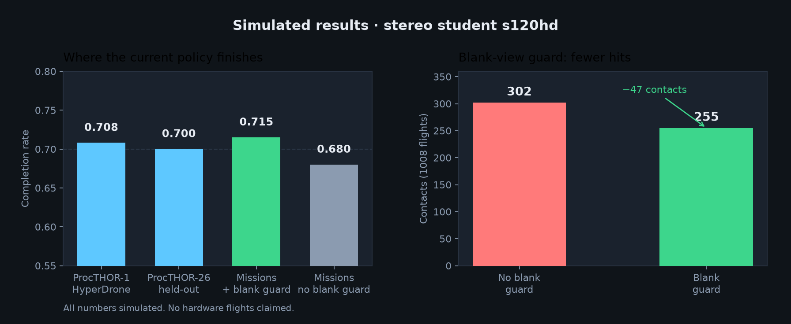

# drone-rl

A learned local navigator for a cheap indoor drone.

The idea is simple: a VLM (or any upstream planner) looks at the camera and picks the next waypoint that is already in view. The onboard stack's only job is to get there fast, without hitting anything, using what a real micro-drone can actually sense - stereo depth, ego motion, and that waypoint. No map of the room. No privileged laser. No "assume the wall is there because the sim said so."

This repo is the policy, the stereo noise model, the training/grading loop, and an honest simulated evaluation. Hardware bring-up (ESP32-S3 flight control, dual cameras, onboard stereo) is the next chapter; the work here is the sim-to-real prep for that stack. **All numbers below are simulated.**

<p align="center">
  <br>
  <em>Furniture + a moving obstacle - newly rendered 5× arrival replay (archived depth planner).</em>
</p>

<p align="center">
  
  <br>
  <em>Staggered walls (6×) · Warframe Complex arrival (5×). Successful sim replays, not stereo-student evals.</em>
</p>

<p align="center">
  
</p>

## Why this exists

I first built a path planner over a local map. In clean depth it looked great - zero contacts on the source missions. Under realistic stereo it fell apart. Textureless walls and JPEG'd OV-class cameras punch huge holes in the depth image, and a planner that trusted empty cells flew straight into them.

So I threw out the "plan the whole route" mindset. The policy now aims straight at the waypoint as if unseen space is open, and only reacts when nearby depth confirms an obstacle. Far-away unknown space does not matter. What matters is not hitting what is close, then getting back on the line to the goal.

The old planner is under [`archive/path_planner/`](archive/path_planner/) and is not built by default. The animations above are newly rendered from successful logged runs of that archived depth planner (the map fills as its depth camera sees), not rollouts of the released stereo student.

## How I approach it

**Privileged teacher → deployable student (DAgger).**  
A teacher sees the true local geometry and learns with PPO. A smaller student sees only what the drone will have onboard: a short depth history, ego state, and the waypoint. The student flies (mixed with the teacher early on); the teacher labels every state; the student regresses onto those labels. After DAgger, optional student-side PPO lets it learn what *its own* view can safely do - something pure imitation never teaches.

**Stereo on purpose.**  
The real target is two cheap cameras on an ESP-class board, not a depth camera. I chose stereo because that is what the hardware will have, and because it forces the policy to live with holes, speckles, and FOV limits instead of cheating with perfect range. Training and grading use calibrated StereoBM-style presets (matched to HyperDrone hole rates), with optional real HyperDrone RGB stereo closed-loop for the headline check. SGBM was heavier for little gain at the resolutions that fit onboard.

**Rewards that match the job.**  
Every tick scores progress toward the current waypoint (dense distance improvement), a small time cost so it does not dawdle, and a heavy contact penalty that ends the episode. Near the goal it also penalizes rushing so arrivals settle cleanly. That is the whole contract: arrive, do not touch, do not waste time. No reward for exploring unknown space. No reward for hugging a remembered map.

**Domain randomization that transfers.**  
Missions are generated: rooms, cross-walls with gaps, pillars on the line, overhanging slabs, narrow slots you must go around, and 3D paths where the waypoint sits above, below, or through a window/doorway. Depth is randomized through FOV, presets, despeckle, and camera-like degradation rather than perfect voxels. Guards that only use onboard quantities (blank forward sector → slow and yaw to find texture; short-term occupancy memory; narrow-gap route fallback) sit on top of the student. A "remember holes as obstacles" idea was tried and made things worse - so it stays off.

**What I cut.**  
Fly-under-table is out of the headline: it is a missing skill, not a perception win. Hole-memory persistence hurt completion. The old path planner's clean-depth scores are not claimed here.

## What worked

The blank-view guard was the clearest win: when most of the forward sector returns no depth, cap speed and yaw until texture appears. On the original mission set that lifted completion and cut contacts versus the same student with only memory + narrow-gap (see [docs/BLANK_GUARD.md](docs/BLANK_GUARD.md)).

Current simulated headline numbers for `s120hd`:

<p align="center">
  
</p>

Under real HyperDrone stereo (not just the preset), the released 120° student (`s120hd`) completes most of ProcTHOR-1 and a held-out ProcTHOR-26 split with few contacts for this class of stack - details in [docs/RESULTS.md](docs/RESULTS.md) and [docs/HYPERDRONE.md](docs/HYPERDRONE.md). Failure analysis says the remaining hits are mostly still perception holes and side/low blockers, not "saw it clearly and flew in anyway" ([docs/FAILURES.md](docs/FAILURES.md)).

Released weights: [`checkpoints/s120hd.bin`](checkpoints/s120hd.bin) (best overall), [`checkpoints/s90hd.bin`](checkpoints/s90hd.bin) (stronger on the small held-out set).

## Quick start

Linux needs a BLAS (`sudo apt install cmake g++ libopenblas-dev`). macOS uses Accelerate.

```sh
./reproduce.sh
```

Builds the grade/train binaries, runs the RAPTOR runtime test, and smoke-grades `s120hd` on one public mission. Full portfolio grading and CPU teacher/student training commands live in the docs and `rlv2/train_cpu.cpp` comments.

## Layout

| Path | What |
|---|---|
| `rlv2/` | CPU train/grade, depth presets, guards, mission generation |
| `checkpoints/` | Released students |
| `docs/` | Depth research, HyperDrone eval, failures, blank-guard A/B |
| `missions/` | Evaluation missions |
| `include/navigation/` | RAPTOR adapter + voxel world used by the grader |

Optional Apple Metal high-throughput training is documented in [docs/MAC_METAL.md](docs/MAC_METAL.md); it is not required to grade the shipped checkpoints on Linux.

## Hardware target

Intended deployment under ~$50: ESP32-S3 for flight control, two OV5647 (or OV2640) cameras into a cheap MIPI-capable host for stereo + policy, VLM waypoints off-board over Wi-Fi. Firmware is not finished in this tree; the policy and stereo noise model are.

## Licence

MIT. RAPTOR weights and L2F dynamics keep their upstream notices in [THIRD_PARTY_LICENSES.txt](THIRD_PARTY_LICENSES.txt).
