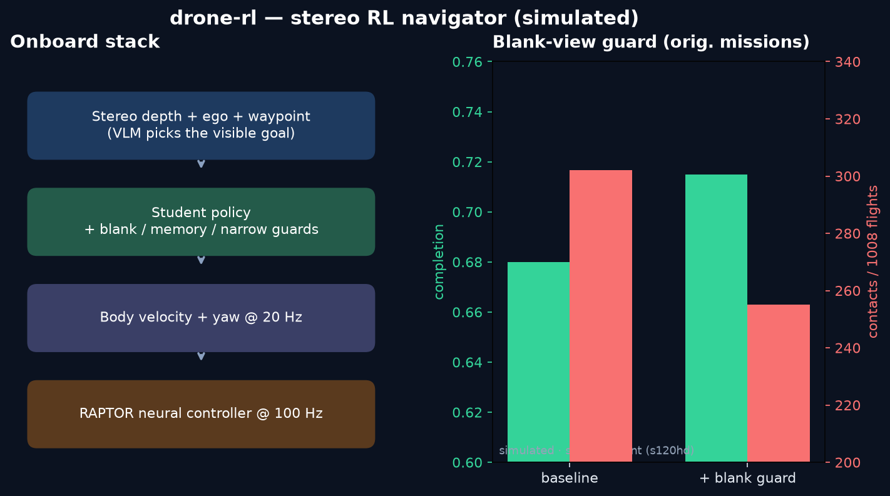

# drone-rl

**Learned collision-free flight to a camera-visible waypoint**, for a cheap indoor drone that only has stereo cameras, IMU, and an onboard policy.

A VLM (or any upstream planner) names the next waypoint already in the image. This stack’s job is everything after that: reach it quickly, without contact, with no prior map and no depth camera — only stereo that looks like real OV-class hardware.



Sim-to-real prep for an under-$50 build (ESP32-S3 flight control, dual cheap cameras, stereo + policy onboard; VLM off-board). Firmware is not in this tree yet. **All evaluation numbers are simulated.**

---

## Problem

A classical local path planner over a voxel map looked perfect on clean depth (including zero-contact runs on the source missions). Under realistic stereo — textureless walls, JPEG, narrow FOV — depth holes open up and the planner treats them as free space. It flies into walls it never measured.

The fix is not a better map. It is a policy that **aims straight at the waypoint as if unseen space is open**, and only adjusts when nearby depth confirms an obstacle. Far-away unknown cells do not matter; contacts do.

The old planner is kept under [`archive/path_planner/`](archive/path_planner/) and is not built by default.

## Approach

| Piece | Choice |
|---|---|
| **Learning** | Privileged teacher (PPO on true local geometry) → deployable student via **DAgger**, then optional student PPO so it learns what *its own* view can safely do |
| **Sensing** | **Stereo on purpose** — that is what the hardware will have. Training/grading use StereoBM-style presets matched to HyperDrone hole rates; headline checks also run closed-loop on real HyperDrone RGB stereo |
| **Reward** | Dense progress to the waypoint, small time cost, heavy contact penalty (episode end), soft brake near arrival. No explore bonus. No map-hugging reward |
| **Randomization** | Procedural rooms: gaps, pillars, slabs, narrow slots, 3D goals through windows/doors; FOV and depth degradation varied. Onboard-only guards on top (blank-view slow+yaw, short occupancy memory, narrow-gap fallback). “Remember holes as obstacles” was tried and **hurt** — left off |
| **Dropped** | Fly-under-table missions (missing skill, not a perception win); clean-depth path-planner scores as a success claim |

Released students: [`s120hd.bin`](checkpoints/s120hd.bin) (best overall), [`s90hd.bin`](checkpoints/s90hd.bin).

## What worked

- **Blank-view guard** — when the forward sector is mostly empty of depth, slow to 0.3 m/s and yaw until texture returns. Clearest win vs the same student with only memory + narrow-gap ([docs/BLANK_GUARD.md](docs/BLANK_GUARD.md)).
- **`s120hd` under real HyperDrone stereo** — completes most of ProcTHOR-1 and a held-out ProcTHOR-26 split with few contacts for this stack class ([docs/RESULTS.md](docs/RESULTS.md), [docs/HYPERDRONE.md](docs/HYPERDRONE.md)).
- Remaining failures are still mostly **unmeasured surfaces and side/low blockers**, not “saw it clearly and hit it anyway” ([docs/FAILURES.md](docs/FAILURES.md)).

## Quick start

```sh
# Linux: sudo apt install cmake g++ libopenblas-dev
./reproduce.sh
```

Builds grade/train binaries, runs the RAPTOR + VisibleWorld smoke test, and grades `s120hd` on one public mission. Full grade/train usage is in the headers of `rlv2/grade.cpp` and `rlv2/train_cpu.cpp`. Numbers and method notes live under [`docs/`](docs/).

## Licence

MIT. RAPTOR / L2F notices: [THIRD_PARTY_LICENSES.txt](THIRD_PARTY_LICENSES.txt).
