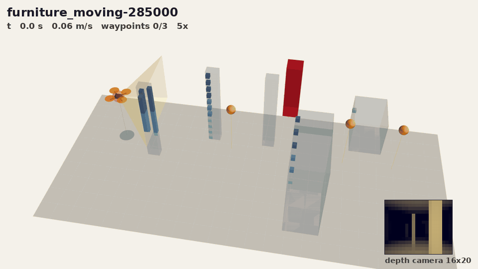
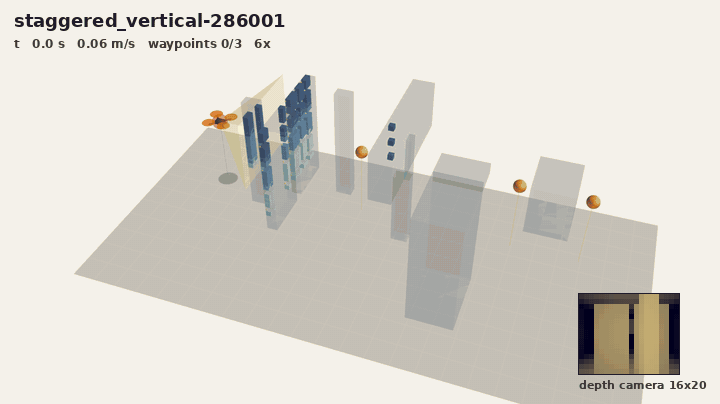
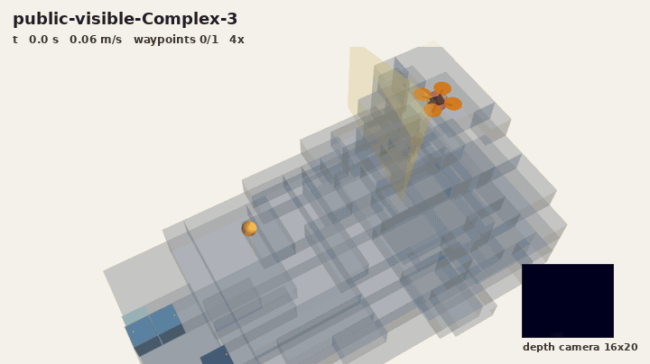
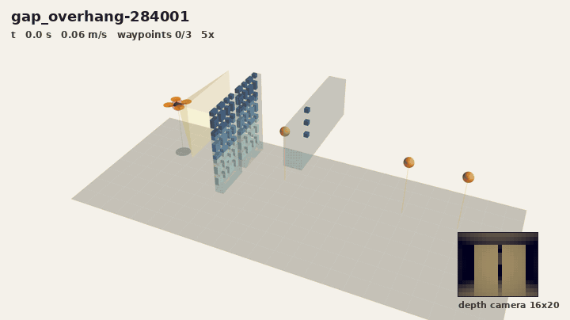
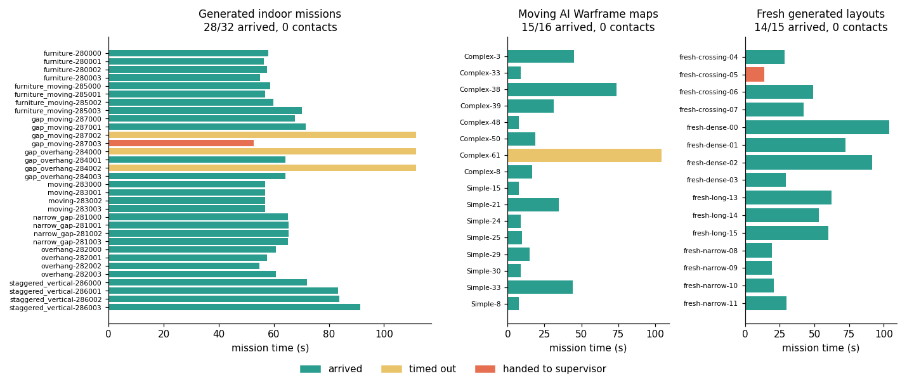

# Map-free drone navigation

I wanted a drone that could fly through a room it had never seen, with nothing but a tiny 16x20
depth camera. No map up front. It builds one as it goes and only flies through space it has actually
looked at. Before it sends any command, it simulates that command plus the full stop afterwards, and
throws it out if the drone would end up somewhere it hasn't seen.

None of this is a kinematic toy. Every command goes through the
[RAPTOR](https://github.com/rl-tools/raptor) neural flight controller and a full quadrotor physics model,
and the simulator checks for contact every 10 ms.

<p align="center">
  <br>
  <em>Furniture and a moving obstacle (red), three waypoints, no contacts. Replay of mission furniture_moving-285000 at 5x.</em>
</p>

Walls start out faint and fill in once the camera has actually hit them, so you can watch the map
grow. The yellow dots are what the camera sees right now, the cone is where it's pointing, and the
little inset in the corner is the raw depth frame the navigator gets. I drew the drone at twice its
real size so you can see it. The orange sphere around it is its true 0.18 m collision radius.

<p align="center">
  
  <br>
  <em>Left: staggered walls (staggered_vertical-286001, 6x). Right: a Warframe game level from the Moving AI benchmarks (public-visible-Complex-3, 4x).</em>
</p>

<p align="center">
  <br>
  <em>Gap and overhang (gap_overhang-284001, 5x).</em>
</p>

## Results

I ran all 63 missions with `./reproduce.sh` on Linux x86-64 (8-core Intel Xeon, GCC). A mission
only counts if the drone reaches every waypoint without touching anything. It gets one waypoint at a
time, and only once that waypoint is visible from where it is.

| Missions | Count | Succeeded | Waypoints | Contacts |
|---|---|---|---|---|
| Generated rooms: furniture, gaps, overhangs, staggered walls, moving obstacles | 32 | 28 | 85/96 | 0 |
| [Moving AI](https://movingai.com/benchmarks/voxels.html) Warframe levels | 16 | 15 | 15/16 | 0 |
| Fresh generated layouts: dense, crossing, narrow, long | 15 | 14 | 20/21 | 0 |
| **Total** | **63** | **57** | **120/133** | **0** |

<p align="center"></p>

- Zero collisions across every mission. Six missions failed: four ran out of time on a waypoint,
  and in two the drone stopped and asked for help because it couldn't prove any move was safe.
  I would much rather it do that than guess.
- It flew 824 m in total. Top speed is capped at 0.65 m/s.
- A planning step takes 0.79 ms on average (single-threaded, 20 Hz loop). The slowest one I saw was
  under 10 ms.
- The whole navigator state fits in 95,912 bytes.

## How it works

Twenty times a second, the navigator gets one depth frame and the drone's pose. Here's what it does
with them.

1. **Map.** The camera has 320 rays. Wherever a ray passes, that cell of a 0.25 m grid is marked
   free. Wherever it stops, the cell is marked as a wall. Anything no ray has touched stays unknown.
2. **Route.** A* looks for a path to the waypoint through free cells only. The path has to leave room
   for the 0.18 m body plus a 0.08 m margin.
3. **Check.** This is the part I care most about. Before a velocity command goes out, I simulate it
   through the RAPTOR controller and the drone's dynamics, then keep simulating while it brakes to a
   full stop. If the body stays in seen-free space the whole way, the command is allowed. If no
   command passes, the drone stops or asks a supervisor. It never guesses.
4. **Look.** If unknown space is in the way, the drone turns to look at it, or moves somewhere free
   that has a better view. At the start of each mission it turns in place to scan the room first. If
   something changes between frames, it's treated as a moving obstacle: the drone keeps an eye on it
   and steers clear.
5. **Fly.** RAPTOR turns the command into motor speeds at 100 Hz. The simulator steps the physics and
   checks for contact every step.

## Quick start

You need CMake 3.16+, a C++17 compiler and Python 3. ffmpeg is only needed if you want to render
replays.

```bash
python3 -m venv .venv && source .venv/bin/activate
pip install -r requirements.txt
./reproduce.sh              # build, run the tests, fly all 63 missions, redraw media/results.png
```

On 8 cores it takes about 25 seconds. Every mission leaves a JSON report and its traces (pose,
commands, depth frames) in `results/<portfolio>/`.

To fly just one set or one mission, or to render your own replay:

```bash
python3 scripts/run_missions.py public
python3 scripts/run_missions.py source --only overhang-282000
python3 scripts/render.py source furniture_moving-285000 replay.gif --elevation 45 --zoom 1.35 --azimuth -80
```

`render.py --still 20 40` saves single frames instead of a clip. The replays are drawn purely from
what was recorded during the run.

## Limitations

- It's all simulation. Nothing here has flown on a real drone yet, and the pose comes straight from
  the simulator, not from a state estimator.
- Some seeds produced identical layouts, so the 32 generated missions are really 24 different ones.
- I ran the fresh layouts while I was still developing, so they aren't a true held-out test.
- My original runs on macOS arm64 scored 29/32, 16/16 and 13/15. Each platform gives the same answer
  every time, but small floating-point differences between them flip a few close missions.
- It's slow. Speed is capped at 0.65 m/s, and the opening scan takes 4 to 12 s per mission.

## Layout

```
include/navigation/   mapping, route search, motion checks, camera attention, runtime wrapper
include/physics.hpp   quadrotor dynamics (port of the RLtools L2F environment)
include/raptor.hpp    RAPTOR policy inference
src/benchmark.cpp     mission runner: simulator, depth rendering, contact checks, logging
tests/                runtime contract test
assets/raptor.bin     RAPTOR policy weights
missions/             task files and voxel maps
scripts/              batch runner, results plot, 3D replay renderer
```

## License

MIT. RAPTOR and the L2F dynamics are by Jonas Eschmann (MIT). The Warframe maps are by Daniel Brewer,
Nathan Sturtevant and Digital Extremes, under the Open Data Commons Attribution License. See
`THIRD_PARTY_LICENSES.txt`.
