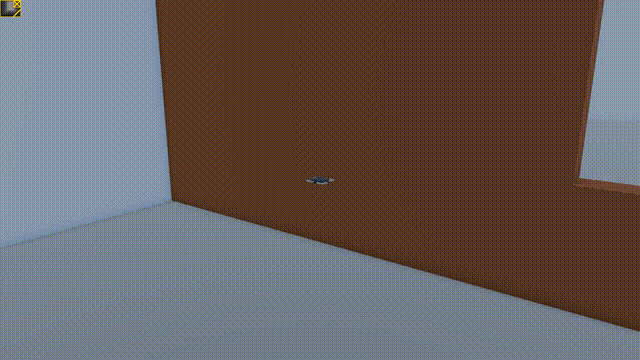
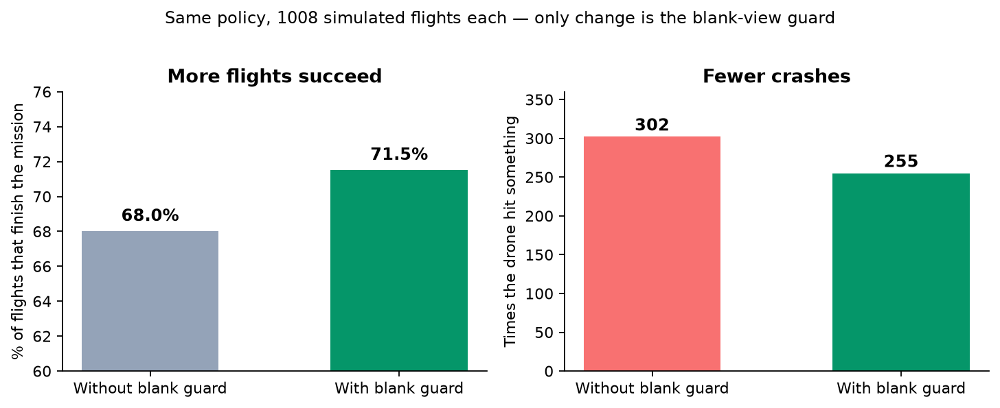

# drone-rl

**Learned collision-free flight to a camera-visible waypoint**, for a cheap indoor drone that only has stereo cameras, IMU, and an onboard policy.

A VLM (or any upstream planner) picks the next waypoint that is already in the camera image. The drone’s job is just: get there fast, don’t hit anything. No map of the room. No depth camera — only stereo that looks like real cheap OV cameras.



*Simulated flight: drone goes through a doorway toward a waypoint it can see.*

Sim-to-real prep for an under-$50 build (ESP32-S3 flight control, dual cheap cameras, stereo + policy onboard; VLM off-board). Firmware is not in this tree yet. **All numbers are simulated.**

---

## Problem

I first built a local path planner over a voxel map. On clean depth it looked great (including zero-contact runs). Under realistic stereo — blank walls, JPEG, narrow FOV — the depth image is full of holes, the planner treats holes as free space, and it flies into walls it never measured.

So the policy now aims **straight at the waypoint** as if unseen space is open, and only reacts when nearby depth confirms an obstacle. Far-away unknown cells don’t matter. Not hitting what’s close does.

The old planner is under [`archive/path_planner/`](archive/path_planner/) and is not built by default.

## Approach

| Piece | Choice |
|---|---|
| **Learning** | Privileged teacher (PPO on true geometry) → onboard student via **DAgger**, then optional student PPO |
| **Sensing** | **Stereo on purpose** — matches the real hardware. StereoBM-style noise in training; HyperDrone RGB stereo for headline checks |
| **Reward** | Get closer to the waypoint each tick, small time cost, big penalty for contact. No explore bonus |
| **Randomization** | Procedural rooms (gaps, pillars, slabs, 3D goals through doors/windows) + FOV/depth noise. Guards on top: blank-view, short memory, narrow-gap. “Remember holes as obstacles” made things worse — off |
| **Dropped** | Fly-under-table missions; claiming the old clean-depth planner scores |

Released weights: [`s120hd.bin`](checkpoints/s120hd.bin) (best overall), [`s90hd.bin`](checkpoints/s90hd.bin).

## What worked

When most of the view ahead has **no depth** (blank wall / hole), the blank-view guard slows the drone and turns until texture returns. Same policy, same 1008 simulated flights — only that guard changes:



Left: more flights finish the mission. Right: fewer times it hits something.

Under real HyperDrone stereo, `s120hd` also completes most of ProcTHOR-1 and a held-out ProcTHOR-26 split ([docs/RESULTS.md](docs/RESULTS.md)). Remaining hits are mostly still unmeasured surfaces and side/low blockers ([docs/FAILURES.md](docs/FAILURES.md)).

## Quick start

```sh
# Linux: sudo apt install cmake g++ libopenblas-dev
./reproduce.sh
```

Builds grade/train binaries, runs a RAPTOR + depth smoke test, grades `s120hd` on one public mission. Details: `rlv2/grade.cpp`, `rlv2/train_cpu.cpp`, [`docs/`](docs/).

## Licence

MIT. RAPTOR / L2F notices: [THIRD_PARTY_LICENSES.txt](THIRD_PARTY_LICENSES.txt).
